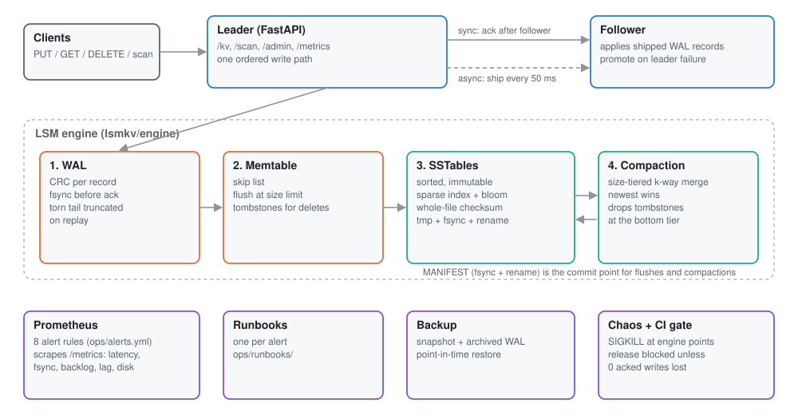
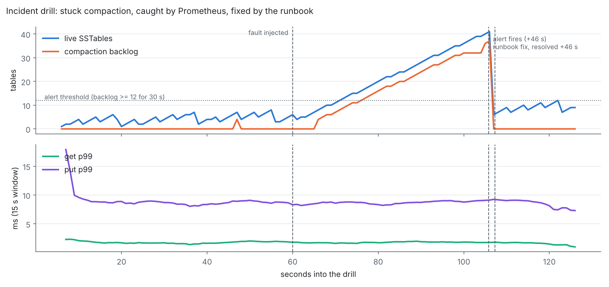
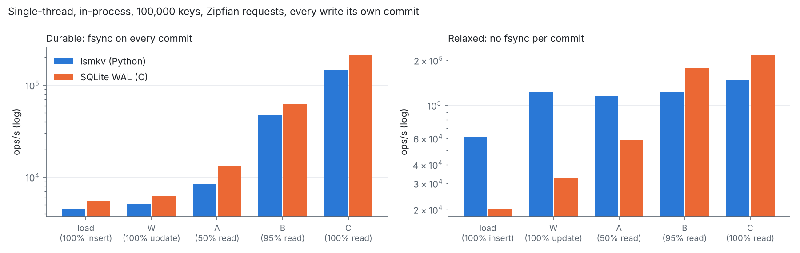

<div align="center">

# Replicated LSM Key-Value Store

**A crash-safe LSM-tree key-value store in Python, run like a production service.** Write-ahead log, skip-list memtable, SSTables with bloom filters, size-tiered compaction and leader-follower replication. Monitored with Prometheus alerts and runbooks, backed up with point-in-time restore, and released only through a crash-recovery canary gate.

[](https://github.com/Jitesh-Mishra/replicated-lsm-kv-store/actions/workflows/ci.yml)


| **0 lost** | **0 vs 257** | **120,000 of 120,000** | **46 s** |
|:---:|:---:|:---:|:---:|
| acknowledged writes across 500 SIGKILL injections (365,005 acked ops), 0 corrupt reads | acknowledged writes lost on leader failover, sync vs async replication (5 kills each) | keys matched an oracle after 6 point-in-time restores | from a stuck compaction to a firing Prometheus alert; runbook fix cleared it in under 1 s |

</div>

<picture>
  <source media="(prefers-color-scheme: dark)" srcset="docs/img/architecture-dark.svg">
  
</picture>

> **The honest summary.** The durability story holds up under every test I could throw at it. Performance does not beat SQLite where it matters most: with an fsync on every commit, SQLite (C, B-tree) is 22% faster on writes and 47% faster on reads. Without a per-commit fsync, the LSM design wins on writes, 3.0x on bulk load and 3.8x on updates. SQLite still reads faster. All numbers are from one 2-vCPU cloud VM, single-threaded and in-process.

## What a database promises, and how this one keeps it

A write is acknowledged only after it's in a checksummed log, fsynced. Everything else (memtable, SSTables, compaction) can be rebuilt from that log and the MANIFEST.

| Piece | What it does | File |
|---|---|---|
| WAL | `length, crc32, seq, ts, op, key, value` per record; fsync `always`, `batch` or `none`; replay stops at the first torn or bad-checksum record and truncates there | `lsmkv/engine/wal.py` |
| Memtable | Skip list (expected O(log n)); deletes are tombstones; flushes at a size limit | `lsmkv/engine/memtable.py` |
| SSTable | Sorted entries, a sparse index every 16 keys (binary search, then scan at most 16), bloom filter, whole-file CRC; written to a temp file, fsynced, renamed, directory fsynced | `lsmkv/engine/sstable.py` |
| Bloom filter | Double hashing (Kirsch-Mitzenmacher), sized from the target false-positive rate | `lsmkv/engine/bloom.py` |
| Compaction | Size-tiered: merges 4 or more neighbouring tables of similar size with a k-way heap merge, newest wins; tombstones dropped only when the merge reaches the oldest table | `lsmkv/engine/db.py` |
| MANIFEST | The commit point. A flush or compaction counts only once a new MANIFEST is renamed into place; anything else on disk is an orphan, removed on open | `lsmkv/engine/db.py` |
| Replication | Leader ships WAL records to a follower: `sync` acknowledges after the follower has them in its own fsynced WAL, `async` ships every 50 ms | `lsmkv/service/server.py` |
| Backup | Snapshot (flush, then copy MANIFEST and tables) plus archived WAL segments; restore to any timestamp by replaying records after the snapshot | `lsmkv/engine/db.py`, `ops/backup_restore.py` |

Engine: 809 lines of Python, standard library only.

## Results

### 1. Crash recovery: 500 SIGKILLs, nothing acknowledged lost

`chaos/crash_harness.py`: a child process writes as fast as it can (75% puts, 25% deletes over 2,000 keys, 8 KiB memtable so it flushes and compacts constantly) and reports each operation before and after the store returns. The parent SIGKILLs it, reopens the store and checks every key against a model built only from acknowledged operations. Each round continues on the same directory, so damage would accumulate.

| | fsync = always | fsync = none |
|---|---:|---:|
| SIGKILL injections | **500** | 200 |
| Acknowledged operations | 365,005 | 649,839 |
| Acknowledged writes lost | **0** | 0 |
| Corrupt reads (value never written, or a read error) | **0** | 0 |
| In-flight op at the kill (either outcome is correct) | 388 landed, 99 not | 132 landed, 52 not |
| Recovery time, p50 / p99 | 1.1 / 3.6 ms | 1.3 / 3.9 ms |

Where the kills landed (fsync = always): 250 at a random moment, and 250 at named points inside the engine. Those were: 142 around the WAL append, 69 inside a flush (after the SSTable, after the MANIFEST, after the WAL was retired), 29 inside a compaction (before or after the MANIFEST swap), and 10 between the SSTable write and its rename.

**What this does and doesn't prove.** SIGKILL tests a process crash. The OS keeps data it accepted, which is why `fsync=none` also loses nothing here. Power loss is what fsync protects against. That's covered by the WAL's torn-tail tests and by the design (fsync before ack, temp file plus rename plus directory fsync), not by this harness.

**The harness catches real bugs.** Moving one line, retiring the old WAL before the MANIFEST names the new SSTable, lost 1,233 acknowledged writes in 150 rounds in CI. All 12 unit tests still passed on that bug. That is why the release gate runs the harness, not just the tests (section 6).

### 2. Replication: what failover costs in each mode

`chaos/failover.py`: leader and follower as separate processes, fsync on both, 8 client threads writing unique keys. The leader is SIGKILLed at a random 3 to 5 s, then the follower is promoted and every acknowledged key is read back from it.

| | sync | async (ships every 50 ms) |
|---|---:|---:|
| Leader kills | 5 | 5 |
| Acknowledged writes | 5,330 | 18,714 |
| **Lost on failover** | **0** | **257** (38 to 78 per kill) |
| Write throughput, median | 258 ops/s | 881 ops/s |
| Put latency p50 / p99, median | 30.1 / 44.0 ms | 8.4 / 19.1 ms |

Async is 3.4x faster and loses about 50 acknowledged writes per failover, roughly one shipping interval's worth. Sync loses nothing and pays for it on every write. The promoted follower took its first write within 3 to 18 ms. One caveat: in sync mode a write that reaches the leader's WAL but not the follower returns 503 while still being in the leader's log, so clients must retry idempotently (`KVWriteErrors` runbook).

### 3. Backup and point-in-time restore

`ops/backup_restore.py`: 50,000 operations over 20,000 keys with WAL archiving on, snapshot after 20,000, then restores to 5 random moments plus the latest. Every key was compared with an oracle built from the operation log up to that moment.

| | |
|---|---:|
| Restores | 6 |
| Keys checked | 120,000 |
| **Keys matching** | **120,000** |
| WAL records replayed per restore | 3,518 to 30,000, exactly the operations after the snapshot |
| Snapshot time / restore time | 0.07 s / 0.09 to 0.25 s |

### 4. Incident drill: stuck compaction, alert, runbook, recovery

`chaos/incident_drill.py` runs the service and a real Prometheus (`ops/alerts.yml`, the same 8 rules CI validates) under 600 writes/s plus 600 reads/s, then hangs the compaction worker mid-job.

<picture>
  <source media="(prefers-color-scheme: dark)" srcset="docs/img/incident-dark.png">
  
</picture>

| Step | Time after the fault |
|---|---:|
| `KVCompactionBacklog` pending (backlog at or above 12) | 15.9 s |
| **Alert firing** (after its 30 s `for` window) | **45.8 s** |
| Runbook `KVCompactionStuck`: `/admin/status` shows a 40.8 s job and 37 tables waiting, then `POST /admin/compaction/restart` | 45.8 s |
| All alerts clear | **46.4 s** |
| Client errors during the incident | 0 |

The latency lines barely moved. Bloom filters skip most of the extra tables, so a stalled compaction hurts disk and table count long before it hurts reads. That's why the page is on backlog, not latency. The responder is a script following the runbook, so the 0.6 s from fix to clear has no human in it. The write-up is in [`docs/incident_postmortem.md`](docs/incident_postmortem.md).

### 5. Against SQLite, honestly

`bench/ycsb.py`: in-process, single thread, 100,000 keys with 100-byte values, Zipfian requests (YCSB constant 0.99, scrambled), every write its own commit, and a fresh value per write. The fresh value matters: SQLite skips the page write and the fsync when a row is overwritten with identical bytes, and that made my first run meaningless.

<picture>
  <source media="(prefers-color-scheme: dark)" srcset="docs/img/bench-dark.png">
  
</picture>

| ops/s | Durable: lsmkv | Durable: SQLite | Relaxed: lsmkv | Relaxed: SQLite |
|---|---:|---:|---:|---:|
| Load, 100% insert | 4,535 | **5,513** | **61,696** | 20,293 |
| W, 100% update | 5,113 | **6,227** | **122,353** | 32,284 |
| A, 50% read | 8,505 | **13,397** | **115,167** | 58,423 |
| B, 95% read | 47,454 | **62,620** | 123,384 | **177,201** |
| C, 100% read | 145,219 | **213,122** | 146,804 | **217,668** |

<sub>Durable = lsmkv `fsync=always` vs SQLite WAL mode `synchronous=FULL` (an fsync per commit). Relaxed = lsmkv `fsync=batch` (10 ms) vs SQLite WAL mode `synchronous=NORMAL` (no fsync per commit). p50 and p99 latencies are in `reports/bench_vs_sqlite.csv`.</sub>

- **Durable writes are fsync-bound.** Both systems spend about 130 to 180 µs per commit waiting on the disk, so the gap is small: SQLite is 22% faster on load and on updates.
- **Without the per-commit fsync, the LSM write path wins:** 3.0x on load, 3.8x on updates. An LSM write is an append plus a memtable insert. A B-tree write rewrites pages.
- **Reads: SQLite wins** by 1.4x to 1.5x. Its B-tree lookup is C. Mine is Python bloom checks plus a binary search, over 3 tables at this size. Read amplification was 0.35 tables probed per get; bloom filters skipped another 0.35.
- **Bloom filters match theory:** a 1% target measured 1.02% false positives on 200,000 absent keys (9.6 bits per key, 7 hashes); a 5% target measured 5.06%.
- **Caveat:** SSTables are read into memory when opened, so this is a fully cached read path with no block cache or disk reads. Python vs C is most of the read gap.

### 6. Release gate: a broken commit is blocked

`.github/workflows/release.yml`: a release publishes only if 150 SIGKILL rounds lose nothing.
| Branch | Unit tests | Crash gate | Release job |
|---|---|---|---|
| [`canary-demo/wal-retired-before-manifest`](https://github.com/Jitesh-Mishra/replicated-lsm-kv-store/tree/canary-demo/wal-retired-before-manifest) (the one-line ordering bug from section 1) | 12 passed | **failed: 1,233 acknowledged writes lost** | **skipped** |
| `main` | 12 passed | passed: 104,103 acked ops, 0 lost | ran |

Run links: [`reports/canary_gate.md`](reports/canary_gate.md).

## Run it

```bash
pip install -r requirements.txt
pytest -q                                              # oracle tests, torn WAL, corruption, PITR, service, stuck compaction
python -m chaos.crash_harness --rounds 500             # about 3 min
python -m chaos.failover --trials 5                    # about 2 min
python -m ops.backup_restore
python -m chaos.incident_drill --prometheus ./prometheus   # needs a Prometheus binary, about 2 min
python -m bench.ycsb                                   # about 3 min
docker build -t lsmkv . && docker run -p 8080:8080 lsmkv   # then: curl -X PUT localhost:8080/kv/a --data 1
```

API: `PUT/GET/DELETE /kv/{key}`, `GET /scan?start=&end=&limit=`, `GET /metrics`, `GET /admin/status`, `POST /admin/snapshot?dest=`, `POST /admin/compaction/restart`, `POST /admin/promote`. Ops: [alert rules](ops/alerts.yml), [runbooks](ops/runbooks/), [Grafana dashboard JSON](ops/grafana/lsmkv-dashboard.json). Design notes: [`docs/design.md`](docs/design.md), [ADRs](docs/adr/).

## Limitations
- **Single machine, single thread for the engine.** Writes are serialised by one lock; there is no group commit, so durable throughput is one fsync per write.
- **Process crash, not power loss.** Section 1 is honest about what SIGKILL can and can't show.
- **Tables are loaded into memory on open.** No block cache, no mmap, so it doesn't scale past RAM.
- **Replication is one follower, manual promotion, no consensus.** A network partition could produce two leaders. Raft is the real answer.
- **The drill's responder is a script.** MTTR has no human reaction time.

## Next
Group commit (one fsync for many writers), block cache with mmap, leveled compaction to compare against size-tiered, Raft for automatic failover, and a C hot path for the memtable.

---
<sub>**Stack:** Python, LSM-tree, write-ahead log (WAL), SSTables, bloom filters, compaction, replication, Prometheus, Grafana (dashboard JSON), SQLite, pytest, GitHub Actions, Docker, FastAPI. Synthetic workloads only.</sub>
